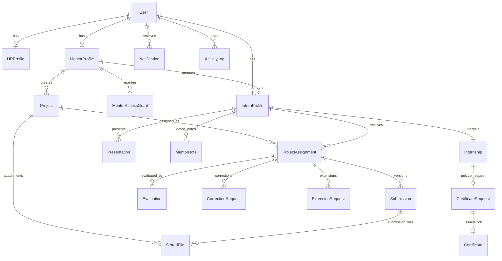

# PHASE 1 & 4: DATABASE DESIGN (PostgreSQL)

## 1. Entity-Relationship Diagram (ERD)

---

## 2. Normalized PostgreSQL Tables & Constraints

| # | Entity / Table | Primary Key & Unique Constraints | Key Foreign Keys & Indexes | Purpose |
|---|----------------|----------------------------------|----------------------------|---------|
| 1 | `User` | `id` (PK), `username` (UNIQUE), `email` (UNIQUE) | `@@index([role])` | Core authentication account (`role`: `ADMIN`, `HR`, `MENTOR`, `INTERN`, `passwordHash`, `isActive`, `mustChangePassword`) |
| 2 | `HRProfile` | `id` (PK), `userId` (UNIQUE) | `userId -> User.id` (Cascade) | HR Manager profile metadata |
| 3 | `MentorProfile` | `id` (PK), `userId` (UNIQUE) | `userId -> User.id` (Cascade) | Mentor phone, `workStartTime`, `workEndTime`; assigned intern count is derived via `_count.interns` |
| 4 | `MentorAccessGrant` | `id` (PK), `@@unique([ownerId, granteeId])` | `ownerId`, `granteeId -> MentorProfile.id` | Admin-authorized directional cross-mentor visibility |
| 5 | `InternProfile` | `id` (PK), `userId` (UNIQUE) | `mentorId -> MentorProfile.id` (SetNull), `@@index([mentorId])` | Intern personal details, `phone1`, optional `phone2`, `email`, `address`, `educationalQualification`, `source` (`DIRECT\|OTHER`) |
| 6 | `Project` | `id` (PK) | `createdByMentorId -> MentorProfile.id` | Reusable project template (`title`, `toolsUsed[]`, `instructions`, `dataSourceText`) |
| 7 | `StoredFile` | `id` (PK) | `projectId -> Project.id`, `submissionId -> Submission.id` | Private file metadata (`kind`: `PROJECT_DATA`, `PROJECT_INSTRUCTIONS`, `SUBMISSION`, `storagePath`, `mimeType`, `size`) |
| 8 | `ProjectAssignment` | `id` (PK) | `projectId -> Project.id`, `internId -> InternProfile.id`, `@@index([status, dueDate])` | Intern-specific assignment (`assignedDate`, `dueDate`, `status` enum of 8 states, `score` 0..100) |
| 9 | `Submission` | `id` (PK), `@@unique([assignmentId, version])` | `assignmentId -> ProjectAssignment.id` | Append-only versioned submission (`version = 1, 2, ...`, `note`, `submittedAt`) |
| 10 | `Evaluation` | `id` (PK) | `assignmentId -> ProjectAssignment.id`, `submissionId -> Submission.id` | Mentor evaluation record (`score`, `feedback`, `decision`: `COMPLETED\|REVISION_REQUIRED`, `evaluatedById`) |
| 11 | `CorrectionRequest` | `id` (PK) | `assignmentId -> ProjectAssignment.id` | Correction instructions attached when evaluation decision is `REVISION_REQUIRED` |
| 12 | `ExtensionRequest` | `id` (PK) | `assignmentId -> ProjectAssignment.id` | Deadline extension request (`reason`, `requestedDate`, `status`: `PENDING\|APPROVED\|REJECTED`, `approvedDate`, `decidedById`) |
| 13 | `Presentation` | `id` (PK) | `internId -> InternProfile.id`, `assignmentId -> ProjectAssignment.id` | Presentation schedule (`scheduledAt`, `googleMeetLink`, `status`: `SCHEDULED\|RESCHEDULED\|CANCELLED\|COMPLETED`) |
| 14 | `MentorNote` | `id` (PK) | `internId -> InternProfile.id`, `mentorId -> MentorProfile.id` | Immutable dated mentor remark (`content`, `createdAt`) |
| 15 | `Internship` | `id` (PK), `internId` (UNIQUE) | `internId -> InternProfile.id` | Overall internship lifecycle (`startDate`, `endDate`, `completionDate`, `completedByMentorId`, `status`: `NOT_STARTED\|ONGOING\|COMPLETED\|CERTIFICATE_PENDING\|CERTIFICATE_APPROVED\|CERTIFICATE_REJECTED`) |
| 16 | `CertificateRequest` | `id` (PK), `internshipId` (UNIQUE) | `internshipId -> Internship.id` | Single certificate approval request per completed internship (`status`: `PENDING\|APPROVED\|REJECTED`, `rejectionReason`) |
| 17 | `Certificate` | `id` (PK), `requestId` (UNIQUE), `certificateNumber` (UNIQUE) | `requestId -> CertificateRequest.id` | Issued PDF certificate (`certificateNumber`, `pdfPath`, `issueDate`) created only after HR approval |
| 18 | `CertificateTemplate` | `id` (PK, `"default"`) | — | Admin-configurable template (`organisation`, `programTitle`, `bodyText`, `signatoryName`, `signatoryTitle`, `accentColor`) |
| 19 | `Notification` | `id` (PK), `@@unique([eventId, recipientId])` | `recipientId -> User.id`, `@@index([recipientId, isRead])` | In-portal notification centre record |
| 20 | `EmailLog` | `id` (PK), `@@unique([eventId, recipient])` | — | SMTP / fallback email delivery audit log (`status`: `SENT\|FAILED\|LOGGED`) |
| 21 | `ActivityLog` | `id` (PK) | `userId -> User.id`, `@@index([createdAt])`, `@@index([entityType, entityId])` | System-wide audit trail for all mutating operations |
