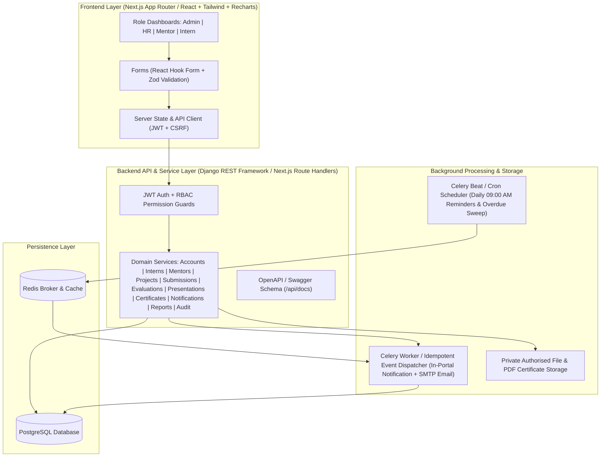

# PHASE 1 & 2: PROJECT ARCHITECTURE

## 1. High-Level System Architecture

The repository delivers a clean, modular, multi-tier architecture supporting both:
1. **Next.js App Router + TypeScript + Tailwind CSS + shadcn/ui + Recharts + Zod + PostgreSQL** (`portal/`)
2. **Python Django + Django REST Framework + SimpleJWT + Celery + Redis + ReportLab + OpenAPI/Swagger** (`backend/`) and **React Frontend** (`frontend/` deployed live on Vercel).



---

## 2. Repository Directory Structure

```text
c:\intern\
├── documentation/
│   ├── REQUIREMENTS.md
│   ├── PROJECT_ARCHITECTURE.md
│   ├── DATABASE_DESIGN.md
│   ├── API_DOCUMENTATION.md
│   └── DEVELOPMENT_ROADMAP.md
├── portal/                         # Next.js 16 (App Router) + TypeScript + Prisma + PostgreSQL + Vitest
│   ├── prisma/                     # schema.prisma, migrations/, seed.ts
│   ├── src/
│   │   ├── app/                    # Role route groups: (auth), (admin), (hr), (mentor), (intern), api/
│   │   ├── components/             # ui/ (modal, dialogs), layout/ (app-shell), charts/ (Recharts)
│   │   ├── lib/                    # auth/, rbac/, validation/ (Zod), storage/, pdf/, events/, cron/
│   │   └── services/               # Modular domain services (user, intern, project, assignment, etc.)
│   └── tests/                      # 7 test files (28 automated tests covering unit, API, RBAC, security)
├── backend/                        # Python Django 5 + DRF + SimpleJWT + Celery + ReportLab + OpenAPI
│   ├── internship_backend/         # settings.py, celery.py, urls.py, wsgi.py
│   ├── portal/                     # Models, serializers, views, services, permissions, tasks, tests
│   └── requirements.txt
├── frontend/                       # Live Vercel SPA bundle connected to API + interactive store
├── docker/
│   └── docker-compose.production.yml
└── README.md
```

---

## 3. Security & Authorization Architecture

1. **Defense-in-Depth RBAC**:
   - **Edge / Proxy Layer**: Verifies signed JWT session and gates `/admin/*`, `/hr/*`, `/mentor/*`, and `/intern/*`.
   - **API Handler / DRF Permission Layer**: Every endpoint enforces `requireRole` / `requireExactRole` (or `IsAdmin`, `IsHR`, `IsMentor`, `IsIntern`).
   - **Query Scope Layer**: `internScope(actor)` and `visibleMentorIds(actor)` filter database queries so a Mentor never sees another Mentor's interns unless an Admin `MentorAccessGrant` exists, and an Intern only ever sees `internId = actor.internId`.
2. **Private File & Certificate Storage**:
   - Files are stored outside `public/` in `STORAGE_DIR` with randomized names.
   - Downloads are served exclusively through `GET /api/files/[id]` and `GET /api/certificates/[id]/download` after verifying role and record ownership.
